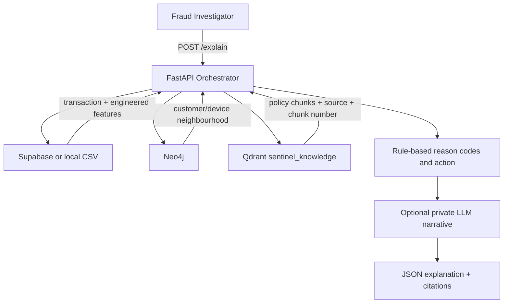

# Project SENTINEL – Fraud Investigator Explanation API

A learning implementation of `POST /explain {"transaction_id": "..."}`. It joins transaction features, optional graph context, and policy retrieval to produce a grounded investigator explanation.

> **Data note:** `data/transactions.csv` and `data/transactions_sentinel_neo4j.csv` are synthetic learning datasets. The ten evaluation transactions are selected from a chronological 80/20 time-based split of the supplied synthetic transaction file. They are not the original PayVista validation holdout. Do not use real customer data with external APIs.

## Architecture



### Why each store exists

| Store | Stores | Why |
|---|---|---|
| Supabase (optional) / CSV demo | Transaction and engineered feature rows | Transaction lookup by `transaction_id`; low-friction tabular access |
| Neo4j (optional) | Customer, Device, Merchant nodes and relationships | Find shared devices and related customer neighbourhoods |
| Qdrant (optional) | 3072-dimensional policy chunk embeddings plus payload | Semantic retrieval of relevant policy text and source citations |
| Local `policy_corpus/` | Synthetic policy examples | Offline retrieval fallback for repeatable tests |
| `outputs/` | API responses and evaluation reports | Reproducible evidence for the assignment |

## 1. Setup (Windows PowerShell)

```powershell
cd path\to\SENTINEL_Fraud_Investigator_API
py -3.13 -m venv .venv
.\.venv\Scripts\Activate.ps1
python -m pip install --upgrade pip
pip install -r requirements.txt
Copy-Item .env.example .env
```

If PowerShell blocks activation, run:
```powershell
Set-ExecutionPolicy -Scope Process -ExecutionPolicy Bypass
.\.venv\Scripts\Activate.ps1
```

## 2. Run locally without cloud credentials

The default mode uses the included synthetic CSV, local policy corpus and deterministic rule-based explanation. Neo4j, Qdrant and LLM switches remain off.

```powershell
uvicorn app.main:app --reload
```

Open `http://127.0.0.1:8000/docs`. Example request:
```json
{"transaction_id":"TXN0000001"}
```

Health check: `GET http://127.0.0.1:8000/health`.

## 3. Optional service connections

### Supabase
Set `USE_SUPABASE=true`, `SUPABASE_URL`, `SUPABASE_KEY`, and `SUPABASE_TABLE` in `.env`. The table must expose `transaction_id` and the feature columns consumed by `reason_codes.py`. Do not assume the table name: confirm it in your Supabase project.

### Neo4j
To load the included synthetic graph data, set Neo4j credentials and run `python scripts/load_neo4j_demo.py`. The loader creates Customer, Device, Merchant and Transaction nodes plus USED_DEVICE, MADE_TRANSACTION and PAID relationships. Then set `USE_NEO4J=true`, `NEO4J_URI`, `NEO4J_USER`, `NEO4J_PASSWORD`. Expected graph relationship: `(Customer)-[:USED_DEVICE]->(Device)`. The query returns a shared-device neighbourhood count. Adapt labels and relationship names to your Task 2 graph if they differ.

### Qdrant + Gemini Embedding 2 via EURI
Set Qdrant/EURI credentials, then run `python scripts/ingest_policy_qdrant.py` to create/verify the 3072-dimensional collection, add the `document_type` keyword index and upsert the included policy chunks. Then set `USE_QDRANT=true`, `QDRANT_URL`, `QDRANT_API_KEY`, `QDRANT_COLLECTION=sentinel_knowledge`, `EURI_API_KEY`. The collection must use a 3072-dimensional unnamed vector and payload keys:
- `source_document`
- `document_type`
- `chunk_number`
- `text`

The service embeds the retrieval query with `gemini-embedding-2-preview` and asks Qdrant for the top 5. The EURI key must remain in `.env`; never commit it or paste it into source code. Confirm model access and account entitlement.

### Optional LLM narrative
Set `USE_LLM=true`, `LLM_API_KEY`, `LLM_BASE_URL`, and `LLM_MODEL` for an OpenAI-compatible endpoint. The deterministic rules still own risk level, reason codes and action; the LLM only writes a narrative from supplied evidence. For a production-aligned PayVista deployment, use an approved privately hosted model inside the approved AWS boundary, not an external hosted LLM.

## 4. Data and features

`data/transactions.csv` is the 5,000-row synthetic source. `data/transactions_with_features.csv` adds illustrative point-in-time features. Rolling customer history is computed in timestamp order using prior records only. Feature thresholds in this demo are transparent teaching rules, not calibrated production thresholds.

Reason codes:
- R01_NEW_DEVICE
- R02_GEO_MISMATCH (reserved; location fields are absent from this sample)
- R03_ODD_HOUR
- R04_FAILED_ATTEMPTS
- R05_AMOUNT_SPIKE
- R06_NEW_ACCOUNT (reserved; account age is absent)
- R07_VELOCITY
- R08_HIGH_RISK_MCC

Missing fields are not guessed. The sample does not contain reliable account age, customer/merchant coordinates or a separate account history, so R02 and R06 are not fabricated.

## 5. Run the ten transaction tests

The file `evaluation/validation_10_transactions.csv` contains five fraud and five genuine IDs selected from the newest 20% time-based slice of the supplied synthetic file. Ground truth is kept separately in `validation_10_transactions_with_ground_truth.csv` for offline evaluation only; it is never included in the explanation prompt.

```powershell
python scripts/evaluate_10_transactions.py
```
Outputs:
- `outputs/explanation_responses.json`
- `outputs/explanation_responses.csv`

## 6. Retrieval hit@5

Ten question/expected-document pairs are in `evaluation/retrieval_questions.json`. Run:
```powershell
python scripts/evaluate_hit_at_5.py
```
This produces `outputs/hit_at_5_report.json`. In the packaged local run, the lexical baseline achieved 10/10 (100%) on these ten synthetic question/document pairs. This is NOT Qdrant hit@5. After Qdrant ingestion and setting `USE_QDRANT=true`, rerun the script to measure actual Qdrant hit@5.

## 7. Tests

```powershell
pytest -q
```

## 8. Important interpretation

This API is an investigator-assistance prototype. A reason code is a rule signal, not a fraud verdict. The sample labels and risk probabilities are synthetic and should be used only to test plumbing and response formats. Do not send confidential data to unapproved hosted services. Production deployment requires authentication, authorization, audit logging, encryption, rate limits, monitoring, approved model hosting, point-in-time feature parity, reviewed policy content and human decision governance.
